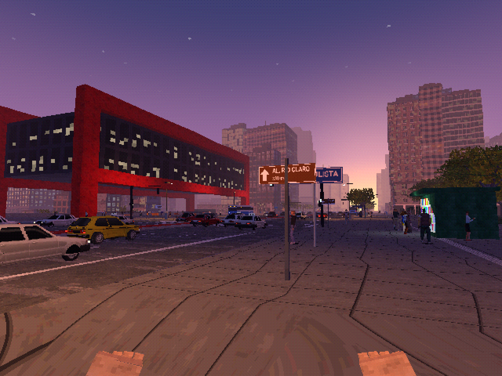

# Paulista PS1

A PS1-style walking simulator in São Paulo: cross Avenida Paulista at MASP and walk down Alameda Rio Claro, built in Godot from real map data.



- **Real streets.** Building footprints and heights come from OpenStreetMap, street relief from GeoSampa's 1 m contour lines, and Alameda Rio Claro is modeled in Blender on top of them.
- **PS1 look.** 640×480 internal resolution, vertex snapping, affine textures, posterized photo textures and fog.
- **A living street.** Traffic with traffic lights, pedestrians on crosswalks and sidewalks, a standing crowd, and 3D audio for the city, cars and footsteps.

## How it was made

Built in about a day with Claude Code:

- Playwright walked Alameda Rio Claro on Google Street View, taking a capture every 30 m as modeling reference (the captures are not used as textures).
- Blender, driven by Python scripts, modeled the Rio Claro street, its calçadão and buildings where no ready-made assets existed, with procedurally painted textures.
- People, cars, props and facades come from CC0 and CC BY packs, listed in [CREDITS.md](CREDITS.md).
- A review agent played the game and reported what was broken; separate agents fixed traffic, crowd, audio, the player, the avenue, Rio Claro and the menus in parallel.

## Run

Open the folder in [Godot 4.7](https://godotengine.org) and press Play, or:

```
godot --path . res://main.tscn
```

| Key | Action |
|---|---|
| W A S D | Walk |
| Mouse | Look |
| Shift | Hold to run, double tap and hold to sprint |
| Space | Jump |
| E | Phone |
| Esc | Menu |

## Layout

- `main.tscn`, `scripts/`: the game (city, traffic, crowd, player, audio, PS1 shaders)
- `assets/`: models, textures, map data and audio
- `lab/`: small scenes to look at buildings, cars, people, props and roads on their own
- `tools/`: the scripts that build the assets: OpenStreetMap and GeoSampa import, Blender models, facade textures, audio, and offscreen screenshots (`tools/shot.sh`)

## Credits

Every third-party asset and its license is listed in [CREDITS.md](CREDITS.md). Map data © OpenStreetMap contributors (ODbL 1.0) and GeoSampa, Prefeitura de São Paulo.
